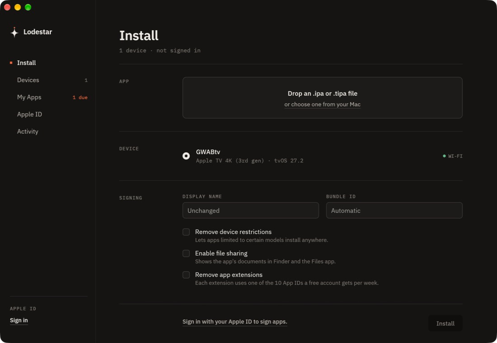
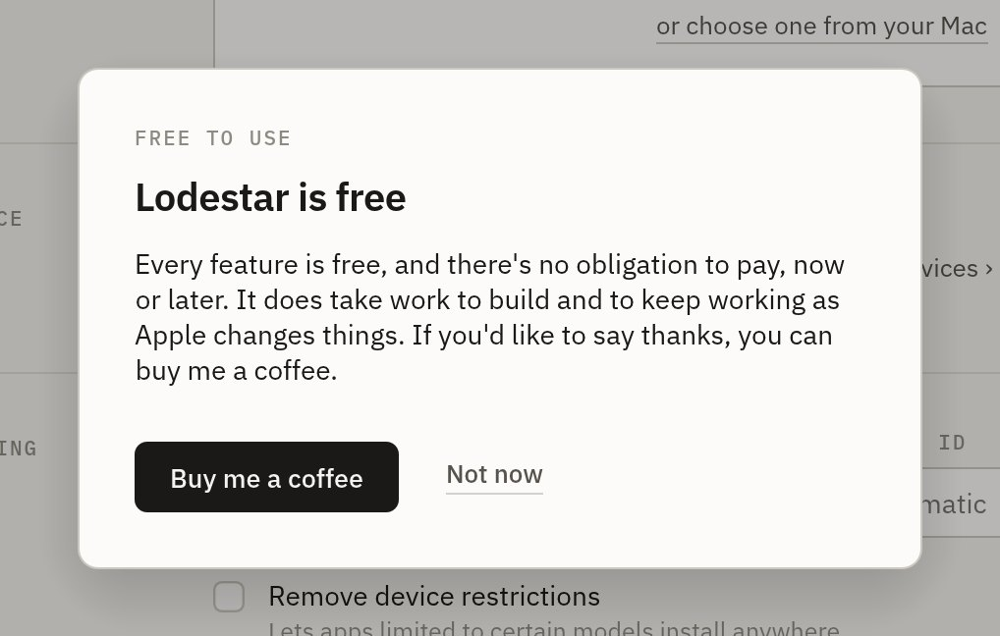

# Lodestar

**Free, open-source sideloading for iPhone, iPad and Apple TV 4K. A native Rust app for your Mac.**

**[Website](https://asroya.github.io/lodestar/)** · **[Download](https://github.com/asroya/lodestar/releases/latest)** · **[Guide](docs/GUIDE.md)**

[](https://github.com/asroya/lodestar/actions/workflows/ci.yml)
[](LICENSE)


<p align="center"></p>

Lodestar signs an `.ipa` (or a tvOS `.tipa`) with your own Apple ID and installs
it on your device. It is one 21 MB native binary: no Python, no Qt, no
Rosetta, no accounts, no analytics, no paid tier. Everything in it is free and
the source is right here.

> Lodestar uses Apple's free developer provisioning, so Apple's free-account
> limits apply: **3 apps per device, signatures that last 7 days, 10 new App IDs
> per week.** Lodestar tracks the countdown and refreshes apps in one click.

## What works today

| | Status |
|---|---|
| Install to **iPhone over USB** | ✅ Verified on hardware |
| Install to **Apple TV 4K** that is already paired with your Mac (Wi-Fi sync) | ✅ Verified on hardware (tvOS 27) |
| Sign in with an Apple ID, two-factor by trusted-device code included | ✅ Verified |
| Reuse or reissue your signing certificate when Apple's limit is hit | ✅ Verified |
| Display name, bundle ID, device-restriction removal, file sharing, extension stripping | ✅ Implemented, unit-tested |
| **Refresh** one or all apps, with a 7-day countdown | 🧪 Same code path as install; not separately verified |
| Two-factor by **SMS** code | 🧪 Implemented, not yet verified |
| **First-time Apple TV pairing with the on-screen PIN**, then install over an encrypted tunnel | 🧪 Implemented, not yet verified on hardware |
| iPad, Wi-Fi sync for iPhones, Intel Macs, tvOS earlier than 17 | 🧪 Expected to work, not tested |

"Verified" means the maintainer ran it end to end (Stremio to an Apple TV 4K and
to an iPhone). The 🧪 rows are code paths that exist but haven't been exercised on
real hardware yet; please report what you find.

## Quick start

**Option A: download.** Grab `Lodestar-arm64.dmg` from
[Releases](https://github.com/asroya/lodestar/releases/latest), open it and drag
Lodestar to Applications. (A zip is attached too.) Release builds are not notarized,
so macOS stops the first launch: on macOS 15 and later, open the app once, then choose
**Open Anyway** in System Settings › Privacy & Security; on macOS 13 and 14,
right-click the app and choose **Open**. Or run:

```bash
xattr -dr com.apple.quarantine /Applications/Lodestar.app
```

**Option B: build it** (about two minutes; needs Rust 1.95+ and Xcode's command line tools):

```bash
git clone https://github.com/asroya/lodestar.git
cd lodestar
./packaging/bundle.sh        # → dist/Lodestar.app
open dist/Lodestar.app
```

Then follow the **[step-by-step guide](docs/GUIDE.md)**: sign in, pick an app,
pick a device, press Install.

## Features

* **One window, three steps.** App, device, options, install. Drag an IPA onto
  the window from anywhere.
* **iPhone, iPad and Apple TV.** USB and Wi-Fi-sync devices come from macOS's
  built-in `usbmuxd`; Apple TVs are found over Bonjour and can be paired with the
  PIN on screen.
* **Knows what it's installing.** Reads the app's platform, version, minimum OS
  and extension count before you commit, and warns when an iOS app is aimed at an
  Apple TV (or the reverse).
* **My Apps.** Every install, with a live countdown, an "online/offline" device
  indicator, **Refresh** and **Refresh all**. A badge warns two days before
  anything expires.
* **Handles Apple's certificate limit.** When your account is at its limit,
  Lodestar frees a slot automatically, preferring its own certificate and never
  touching revoked or expired ones.
* **Your secrets stay on your Mac.** The password (only if you tick *Remember me*)
  and the signing key live in the macOS Keychain. Nothing is stored in plain text.
* **Designed.** Light and dark, IBM Plex type, motion that explains state and
  switches off with macOS *Reduce Motion*.

## What Lodestar doesn't do (yet)

Compared with Sideloadly 0.70 for Mac, which is closed-source, ships as an
`x86_64` build (so it runs under Rosetta on Apple silicon) and takes 285 MB on disk:

* **No background auto-refresh.** Refresh is one click, not automatic.
* **No JIT enabling** and **no tweak or dylib injection.**
* **No Windows or Linux build.** macOS only.
* **No paid developer-account features** such as custom entitlements.

These are good first contributions; see [CONTRIBUTING.md](CONTRIBUTING.md).

## Privacy and security

Lodestar has no telemetry, no update check and no analytics. It talks to three
kinds of server:

1. **Apple**: for example `gsa.apple.com` for sign-in and
   `developerservices2.apple.com` for certificates, App IDs and provisioning
   profiles. Sign-in uses Apple's SRP protocol; your password is never sent as
   plain text.
2. **An anisette server**: Apple requires "anisette" device-identity headers on
   these requests. By default Lodestar uses a community server
   (`ani.jkcoxson.com`, run by the author of `idevice`). It sees your IP address
   and the provisioning exchange, **not your Apple ID password.** To avoid a
   third party, run your own ([anisette-v3-server](https://github.com/Dadoum/anisette-v3-server))
   and set `LODESTAR_ANISETTE_URL=https://your-server`, or `anisette_url` in
   `~/Library/Application Support/Lodestar/settings.json`.
3. **Your own devices**, over USB or your local network.

Use a dedicated Apple ID for sideloading if you can. See [SECURITY.md](SECURITY.md)
for how to report a vulnerability.

## Troubleshooting

| Symptom | Try |
|---|---|
| No devices appear | Unlock the iPhone and tap **Trust**; check the cable. For an Apple TV, keep both on the same Wi-Fi (not a guest network) and allow *Local Network* for Lodestar in System Settings › Privacy & Security. |
| "Maximum number of certificates" | Lodestar frees a slot itself. If it can't, open **Activity**, then revoke one in Xcode › Settings › Accounts › Manage Certificates. |
| "Not enough available App IDs" | Free accounts get 10 new App IDs per 7 days. Tick **Remove app extensions**, or wait for the window to reset. |
| The app won't open on the iPhone | Settings › General › VPN & Device Management › trust your Apple ID; enable **Developer Mode** (Settings › Privacy & Security) on iOS 16+. |
| Something else | **Activity** has a full log. Run with `LODESTAR_LOG=debug` for more. Please include it (with your Apple ID removed) in a bug report. |

## Development

```bash
cargo test                                   # 41 tests, no device or Apple ID needed
cargo clippy --all-targets -- -D warnings
cargo fmt --check
./packaging/check.sh                         # all of the above + bundle, disk image, signature and launch check
./packaging/bundle.sh --zip --dmg            # what a release ships: dist/*.zip and dist/Lodestar-arm64.dmg
./testapp/build.sh                           # tiny tvOS test app → testapp/build/LodestarHello.tipa
LODESTAR_MOTION_SLOWMO=10 cargo run          # animations 10× slower, for design review
```

How it fits together is in [docs/ARCHITECTURE.md](docs/ARCHITECTURE.md).

**Releasing.** Bump `version` in `Cargo.toml`, add `docs/releases/vX.Y.Z.md`, then push a
`vX.Y.Z` tag. The *Release* workflow builds, verifies and attaches the zip, the disk image
and checksums.

**Website.** `site/` is plain HTML, CSS and JavaScript with no build step; preview it with
`python3 -m http.server -d site`. Payment links live in `site/config.js`. The *Website*
workflow checks it in a browser (`packaging/check-site.mjs`) and publishes it to GitHub
Pages from `main`.

## Supporting Lodestar

Lodestar is free, and there's no obligation to pay for it. After your first successful
install it says so once, with an optional **Buy me a coffee** link that stays at the
bottom of the sidebar. The link opens the
[website's support section](https://asroya.github.io/lodestar/#support) in your
browser; Lodestar makes no request of its own. Starring the repository, reporting how
the 🧪 rows above behave on your hardware, and contributing help just as much.

<p align="center"></p>

## Credits and license

Lodestar stands on [`isideload`](https://github.com/nab138/isideload) and
[`idevice`](https://github.com/jkcoxson/idevice); thank you to both authors and
to everyone credited in [THIRD_PARTY_NOTICES.md](THIRD_PARTY_NOTICES.md).
Lodestar's code is [MIT](LICENSE). One dependency, `apple-codesign-quick`, is
LGPL-2.1-or-later; the notices file explains what that means for you.

**Use it responsibly.** Install only software you are entitled to run, and follow
Apple's developer terms. Apple can change its services at any time and break
sideloading tools without notice. Lodestar is an independent project, not
affiliated with or endorsed by Apple or the Sideloadly project, and comes with no
warranty.
